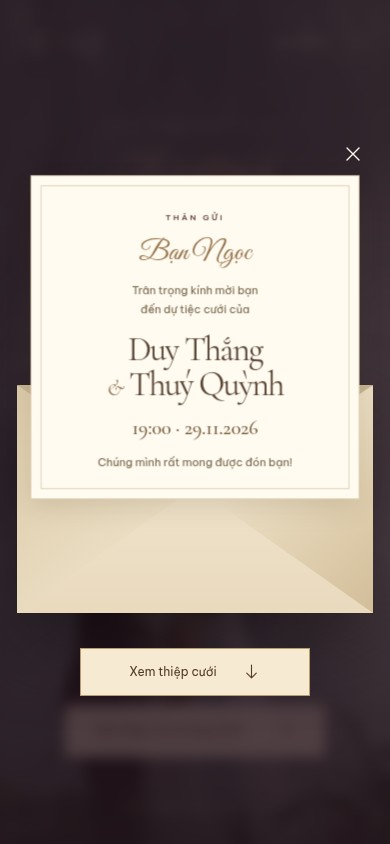
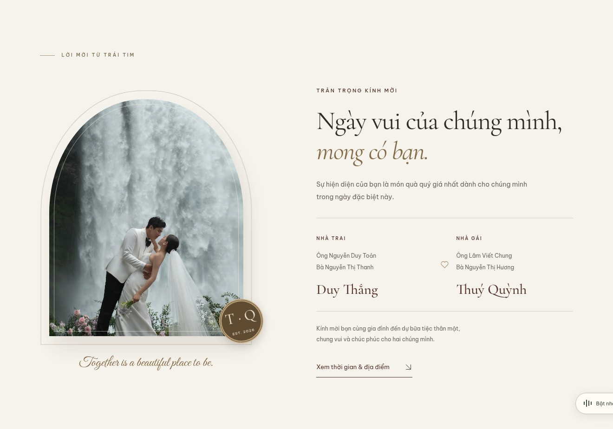
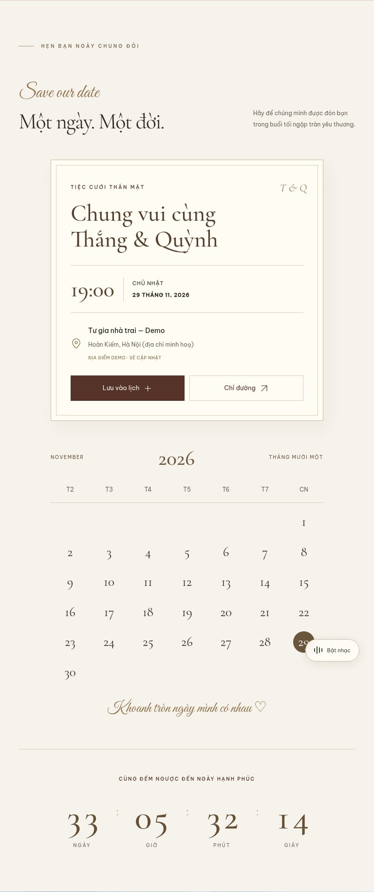

# Kiểm tra giao diện — 27/10/2026

Đây là ảnh chụp từ trang được render trong Chromium, sử dụng ảnh và font thật của dự án.

## Phát hiện và sửa

- Ảnh hero cũ làm hàng grid giãn theo chiều cao nội tại, khiến nội dung và nút mở thiệp mất khỏi màn hình đầu. Hero mới giới hạn theo viewport, dùng ảnh absolute; điện thoại và desktop có cách crop ảnh riêng.
- Tên hai bạn, ngày tiệc và nút mở thiệp luôn nằm trong màn hình đầu ở bảy kích thước được kiểm tra; thời gian không đè lên khuôn mặt trên các ảnh cover đã xem.
- Tăng cỡ chữ nội dung/biểu mẫu; thay các ký tự icon có thể thiếu glyph bằng SVG. Input trên điện thoại dùng 16px để tránh trình duyệt tự zoom khi nhập.
- Phong bì có các lớp giấy, con dấu, nắp xoay và thiệp nổi; thiệp mở không bị cắt trong viewport được kiểm tra. Tôn trọng chế độ giảm chuyển động.
- Trên tablet 768px, phần tiệc cưới chuyển sang một cột để tiêu đề không bị ngắt thành bốn dòng.
- RSVP khôi phục cả số người và lựa chọn có/không sau khi tải lại. Test chặn localStorage kiểm tra thông báo lỗi thay vì báo lưu thành công.

## Kết quả kiểm thử

- **12/12** kiểm thử logic và DOM: múi giờ Việt Nam, ranh giới đếm ngược, lịch năm nhuận, ICS và escaping, lưu trữ lỗi, mở thiệp, album, RSVP và lời chúc an toàn.
- **14/14** kiểm thử trình duyệt: bảy viewport, luồng phong bì/keyboard, album/keyboard, RSVP/reload, lời chúc, tải lịch, reduced motion/storage bị chặn, nhạc bật/tắt.
- Viewport: **320×740, 375×812, 390×844, 430×932, 768×1024, 1440×900, 1920×1080**.
- Đã đọc ảnh chụp cover điện thoại nhỏ/tablet/desktop, lời mời, sự kiện, album, RSVP, lời chúc và phong bì trên mobile/desktop; không có lỗi JavaScript trong lần thu ảnh mobile/desktop.
- Chưa kiểm chứng trên Safari/iOS thật. Screenshot và kiểm tra bounding box không thay thế việc đánh giá thẩm mỹ của cô dâu chú rể.

## Ảnh chụp

### Cover desktop — 1440×1000


### Cover điện thoại — 390×844


### Thiệp mở — điện thoại



### Lời mời — desktop



### Ngày tiệc — điện thoại


### Ngày tiệc — tablet sau khi sửa ngắt dòng



### Album — desktop


### Xác nhận — điện thoại


Một số ảnh toàn section dùng `prefers-reduced-motion: reduce` để mọi khối đều hiển thị khi chụp; ảnh cover được chụp sau khi hiệu ứng ban đầu kết thúc. Các nút cố định trong ảnh toàn section phản ánh vị trí viewport lúc chụp. Toàn bộ luồng mở thiệp còn được test với chế độ chuyển động thông thường.

## Chạy lại

```sh
npm ci
npx playwright install chromium
npm test
npm run test:ui
npm run build
```

Ảnh chụp ở bảy kích thước và báo cáo HTML được upload trong workflow dưới artifact `browser-test-evidence`. Khi có thay đổi giao diện, chạy lại browser tests và `npm run review:ui`, đọc ảnh trước khi cập nhật ảnh trong thư mục này.
