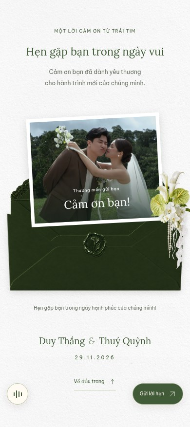

# Kiểm tra thiệp trắng xanh — 27/10/2026

Tham chiếu bố cục: https://jmiiwedding.com/chinhlinhh. Tông trắng xanh và hoa: https://jmiiwedding.com/duyanhhamauu. Trang 3 và phong thư cuối theo ảnh người dùng gửi. Ảnh dưới đây được chụp từ Chromium với ảnh và dữ liệu của Thắng & Quỳnh.

## Đã thay đổi

- Đổi toàn bộ bố cục sang cuốn thiệp dọc, nền giấy trắng và mực xanh lá trầm; phong bì, giấy ren, ngọc trai và dải ảnh theo mẫu mới.
- Màn mở và trang 1 dùng chung các lớp đồ hoạ. Chạm phong bì sẽ hạ mặt phong bì, kéo giấy và ảnh lên, phát nhạc sau tương tác rồi chuyển vào thiệp. Nội dung ẩn và khóa trước thao tác mở.
- Trang 2 dùng ảnh cưới toàn khung và dòng “We are Getting Married”.
- Không có mục Our Story, đoạn hành trình tình yêu hay phần chân dung kể chuyện.
- Bố cục tiếp theo: gia đình và giấy ren chứa tên/ngày giờ/địa điểm → lịch trình dự kiến → lịch đánh dấu trái tim → album ảnh lớn/ảnh nhỏ → RSVP → lời chúc → mừng cưới → phong thư cảm ơn mở ra ảnh.
- Thông tin demo được ghi rõ; không dùng ảnh hoặc API của cặp đôi mẫu.

## Kiểm thử

- **17/17 logic/DOM** đạt.
- **19/19 Chromium** đạt, gồm bảy viewport: 320×740, 375×812, 390×844, 430×932, 768×1024, 1440×900, 1920×1080.
- Kiểm tra khung đầu không tràn ngang, tên/ngày/nút tiếp trong viewport, chặn nội dung trước khi mở, mở một lần, Escape không bỏ qua gate, tải lại quay về màn mở, nhạc, lịch, album, RSVP và lời chúc.
- Bài riêng xác nhận các lớp phong bì xanh và hoa trắng lá xanh, dải hai ảnh, trang thứ hai và không có Our Story.
- Đã xem ảnh render màn mở, trang 1, trang 2, lời mời, sự kiện, album và biểu mẫu trên mobile/desktop. Chưa xác nhận Safari/iOS thật.

## Màn mở


## Trang 1


## Trang 2


## Lời mời và thời gian


## Lịch trình và album


## Xác nhận


Ảnh toàn section dùng reduced motion để các khối hiện đủ khi chụp. Các luồng mở thiệp và bảy viewport còn được kiểm tra với chuyển động thông thường. Một số bài tương tác biểu mẫu dùng reduced motion để tách lỗi biểu mẫu khỏi chuyển động cuộn.

## Chạy lại

```sh
npm ci
npx playwright install chromium
npm test
npm run test:ui
npm run build
```

GitHub Actions lưu báo cáo/ảnh/trace trong artifact `browser-test-evidence`. Ảnh review có thể tạo bằng `npm run review:ui` sau khi mở Vite ở cổng 5173.

## QR nhà trai

Đã thêm VietQR Techcombank cho số tài khoản **1905 0359 9540 16**. Đã giải mã cả ảnh PNG gốc và ảnh QR render trong trình duyệt, xác nhận BIN 970407 và tài khoản 19050359954016, không đặt sẵn số tiền. Đã kiểm tra sao chép đúng chuỗi số, tải PNG, báo lỗi khi clipboard bị chặn và bố cục hộp mừng cưới ở 320px, 390px, 1440px.


## Tông xanh và hoa trắng

Đã giữ bố cục trang 1, trang 2 và cơ chế mở thiệp, chuyển toàn bộ chữ/nút/nền giấy/phong bì/dấu sáp sang trắng–xanh. Thêm hai cụm hoa trắng lá xanh theo mẫu Duy–Hà. QR Techcombank nhà trai vẫn giữ nguyên dữ liệu, màu QR đen trắng và nút sao chép/tải ảnh. Kiểm thử tiếp tục giải mã ảnh QR hiển thị trong trình duyệt để bảo đảm bộ lọc màu không tác động mã thanh toán.

## Trang 3, trái tim ngày 29 và phong thư cuối

Hai gia đình ở phía trên; tên, 19:00 Chủ nhật 29/11/2026, địa điểm demo và nút chỉ đường/lưu lịch nằm trong cùng giấy ren. Hoa trắng lá xanh thay hoa đỏ. Font Lora và Be Vietnam Pro hỗ trợ đầy đủ tiếng Việt; bỏ toàn bộ dress code.

Album dùng một ảnh vuông lớn và dải 18 ảnh nhỏ cuộn ngang, trạng thái ảnh đang chọn, nút trước/sau, bàn phím và lightbox xem ảnh đầy đủ. Kiểm thử xác nhận đổi ảnh, vòng từ ảnh cuối về đầu và đóng/mở lightbox.

Kiểm tra bổ sung khung giấy ren và nội dung không tràn ở 320, 390, 600, 1440px; lịch chỉ đánh dấu 29 bằng trái tim xanh; phong thư cuối mở/khép với Enter/Space, hiện đúng một ảnh và tôn trọng reduced motion. Không áp bộ lọc màu lên ảnh cưới/QR.



