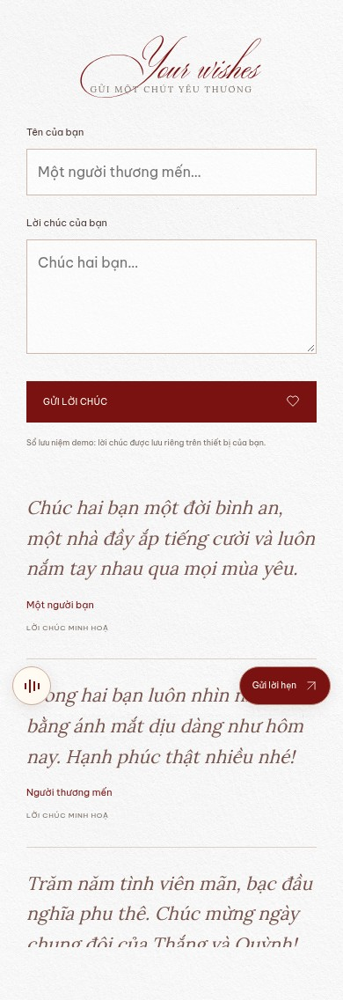
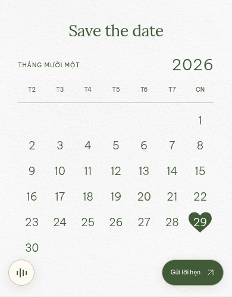
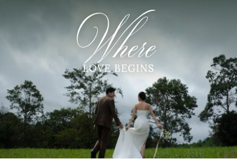
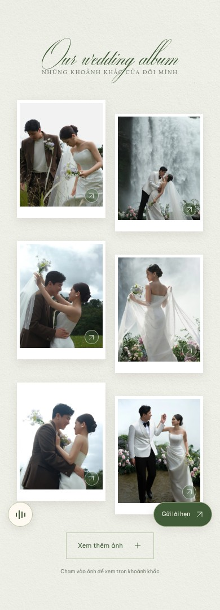
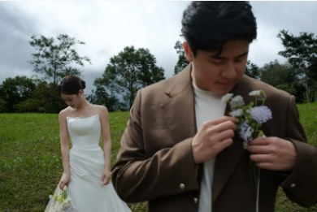

# Kiểm tra thiệp trắng xanh — 30/10/2026

Tham chiếu bố cục: https://jmiiwedding.com/chinhlinhh. Tông trắng xanh và hoa: https://jmiiwedding.com/duyanhhamauu. Trang 3 và phong thư cuối theo ảnh người dùng gửi. Ảnh dưới đây được chụp từ Chromium với ảnh và dữ liệu của Thắng & Quỳnh.

## Đã thay đổi

- Đổi toàn bộ bố cục sang cuốn thiệp dọc, nền giấy trắng và mực xanh lá trầm; phong bì, giấy ren, ngọc trai và dải ảnh theo mẫu mới.
- Trang 0 dùng nền hoa lá và bì thư ren đóng kín; trang 1 giữ thiệp đang mở. Chạm phong bì sẽ hạ mặt phong bì, kéo giấy và ảnh lên, phát nhạc sau tương tác rồi chuyển vào thiệp. Nội dung ẩn và khóa trước thao tác mở.
- Trang 2 dùng ảnh cưới toàn khung và dòng “We are Getting Married”.
- Không có mục Our Story, đoạn hành trình tình yêu hay phần chân dung kể chuyện.
- Bố cục tiếp theo: gia đình và giấy ren chứa tên/ngày giờ/địa điểm → lịch trình ngày cưới → lịch đánh dấu trái tim → album ảnh lớn/ảnh nhỏ → lời chúc Firebase → mừng cưới → phong thư cảm ơn luôn mở sẵn với ảnh.
- Thông tin demo được ghi rõ; không dùng ảnh hoặc API của cặp đôi mẫu.

## Kiểm thử

- **24/24 logic/DOM** đạt.
- **20/20 Chromium** đạt, gồm bảy viewport: 320×740, 375×812, 390×844, 430×932, 768×1024, 1440×900, 1920×1080.
- Kiểm tra khung đầu không tràn ngang, tên/ngày/nút tiếp trong viewport, chặn nội dung trước khi mở, mở một lần, Escape không bỏ qua gate, tải lại quay về màn mở, nhạc, lịch, album, phần lời chúc và việc bỏ RSVP.
- Bài riêng xác nhận các lớp phong bì xanh và hoa trắng lá xanh, dải hai ảnh, trang thứ hai và không có Our Story.
- Đã xem ảnh render màn mở, trang 1, trang 2, lời mời, sự kiện, album và biểu mẫu trên mobile/desktop. Chưa xác nhận Safari/iOS thật.

## Màn mở


## Trang 1


## Trang 2


## Lời mời và thời gian


## Lịch trình và album


## Lời chúc



Ảnh toàn section dùng reduced motion để các khối hiện đủ khi chụp. Các luồng mở thiệp và bảy viewport còn được kiểm tra với chuyển động thông thường. Một số bài tương tác biểu mẫu dùng reduced motion để tách lỗi biểu mẫu khỏi chuyển động cuộn.

## Chạy lại

```sh
npm ci
npx playwright install chromium
npm test
npm run test:ui
npm run build
```

GitHub Actions lưu báo cáo/ảnh/trace trong artifact `browser-test-evidence`. Ảnh review có thể tạo bằng `npm run review:ui` sau khi mở Vite ở cổng 5173.

## QR nhà trai

Đã thêm VietQR Techcombank cho số tài khoản **1905 0359 9540 16**. Đã giải mã cả ảnh PNG gốc và ảnh QR render trong trình duyệt, xác nhận BIN 970407 và tài khoản 19050359954016, không đặt sẵn số tiền. Đã kiểm tra sao chép đúng chuỗi số, tải PNG, báo lỗi khi clipboard bị chặn và bố cục hộp mừng cưới ở 320px, 390px, 1440px.


## Tông xanh và hoa trắng

Đã giữ bố cục trang 1, trang 2 và cơ chế mở thiệp, chuyển toàn bộ chữ/nút/nền giấy/phong bì/dấu sáp sang trắng–xanh. Thêm hai cụm hoa trắng lá xanh theo mẫu Duy–Hà. QR Techcombank nhà trai vẫn giữ nguyên dữ liệu, màu QR đen trắng và nút sao chép/tải ảnh. Kiểm thử tiếp tục giải mã ảnh QR hiển thị trong trình duyệt để bảo đảm bộ lọc màu không tác động mã thanh toán.

## Trang 3, trái tim ngày 29 và phong thư cuối

Hai gia đình ở phía trên; tên, 18:00 Chủ nhật 29/11/2026, địa điểm đã xác nhận và nút chỉ đường/lưu lịch nằm trong cùng giấy ren. Hoa trắng lá xanh thay hoa đỏ. Font Lora và Be Vietnam Pro hỗ trợ đầy đủ tiếng Việt; bỏ toàn bộ dress code.

Album dùng một ảnh dọc 2:3 lớn, hiển thị trọn ảnh, và dải 7 ảnh nhỏ cuộn ngang, trạng thái ảnh đang chọn, nút trước/sau, bàn phím và lightbox xem ảnh đầy đủ. Kiểm thử xác nhận đổi ảnh, vòng từ ảnh cuối về đầu và đóng/mở lightbox.

Kiểm tra bổ sung khung giấy ren và nội dung không tràn ở 320, 390, 600, 1440px; lịch chỉ đánh dấu 29 bằng trái tim xanh; phong thư cuối luôn mở sẵn, hiện đúng một ảnh ở cả hai chế độ chuyển động, không có nút/hướng dẫn bấm mở, tải lại vẫn mở sẵn. Không áp bộ lọc màu lên ảnh cưới/QR.




## Trang 0, địa điểm và chữ Thank you — 28/10/2026

- Nền hoa hồng trắng/lá xanh lấy đúng artwork của mẫu Duy–Hà; phủ lớp xanh tối để tăng tương phản. Chỉ còn một dòng “TRÂN TRỌNG KÍNH MỜI”.
- Bì thư ren trắng đóng kín, chưa lộ giấy mời hoặc dải ảnh. Bấm dấu sáp/phong bì mới hiện giấy và ảnh, sau đó chuyển vào trang 1. Gate vẫn chặn nội dung, chống mở lặp và tôn trọng reduced motion.
- Số ngày trong lịch: Be Vietnam Pro 300, 18px; năm 2026: 26px. Giữ trái tim tại ngày 29.
- Địa điểm chính thức: Nhà văn hoá thôn 3 Công Đình - Phù Đổng - Hà Nội. Nút chỉ đường dùng link Maps do người dùng cung cấp, file ICS chứa đúng địa điểm và không còn nhãn demo cho địa điểm.
- Timeline: 18:00 đón khách, 18:30 lễ thành hôn, 19:00 dùng tiệc.
- Trang cuối luôn mở sẵn. Đưa “Hẹn gặp bạn trong ngày vui” xuống ảnh, thay “Cảm ơn bạn!” bằng “Thank you!” với font Ecatherina giống ảnh mẫu. Bỏ hai đoạn phía trên phong thư. Đã chỉnh cỡ chữ sau khi xem ảnh render để nét thư pháp nằm gọn trong ảnh.

## Album dọc, Where love begins và giờ mời — 29/10/2026

- Album chỉ dùng ảnh Drive số 3, 4, 6, 10, 11, 12, 17. Đối chiếu bằng tên file trong thư mục Drive đã cung cấp; cả bảy ảnh đều có kích thước 1600×2400. Ảnh lớn dùng tỉ lệ dọc 2:3 và contain để thấy trọn ảnh. Dải ảnh nhỏ, chọn ảnh, nút/phím điều hướng và lightbox tiếp tục hoạt động với đúng bảy ảnh.
- Chèn ảnh ngang số 9 (1600×1067) ngay trước Timeline, gần tỉ lệ 3:2 gốc. “Where” dùng font thư pháp Ecatherina, “LOVE BEGINS” dùng Lora, đặt trên phần trời có lớp phủ tối. Đã xem ảnh render và tăng khoảng cách giữa hai dòng để chúng không chồng lên nhau.
- Giờ mời đổi thành 18:00 ngày 29/11/2026. Metadata, đếm ngược và ICS đồng bộ UTC+7 (ICS bắt đầu 11:00 UTC); Timeline vẫn theo lịch trình 18:00 đón khách, 18:30 lễ thành hôn, 19:00 dùng tiệc.
- Kiểm tra thêm banner nằm đúng trước Timeline, ảnh không tràn ngang ở 320, 390, 1440px, caption nằm trong khoảng trời và ảnh album không bị crop.





## Ảnh số 8, thứ tự album và Firebase — 30/10/2026

- Ảnh ngang số 8 nằm giữa Timeline và phần lịch Save the date, tỉ lệ 3:2 và không crop.
- Thứ tự album: 4, 11, 17, 3, 6, 10, 12; ưu tiên ảnh thứ 2, 5, 7 của thứ tự trước.
- Bỏ toàn bộ phần xác nhận tham gia và đường dẫn cũ; nút nổi đổi thành Gửi lời chúc.
- Bỏ lời chúc demo và lưu localStorage. Firebase Anonymous Auth + Firestore dùng namespace riêng, transaction xác nhận server trước khi báo thành công; onSnapshot hiển thị các lời chúc mới nhất cho mọi khách.
- **5/5 rules và 1/1 UI Firebase** đạt bằng Emulator/SDK thật. Hai browser context độc lập đã gửi/nhận dữ liệu và tải lại vẫn thấy; dữ liệu HTML được render như văn bản. Đây là môi trường kiểm thử, không phải Firebase production.
- **Production đã có build config project `thang-quynh`**; Anonymous Auth thành công. Firestore đang chặn quyền đọc/gửi và cần chủ project publish rules. Trang thật không nhận gửi khi server chưa cấp quyền. Chi tiết ở [firebase-setup.md](firebase-setup.md).




## Kết nối build production

Sáu trường Firebase Web config được truyền từ Repository Secrets vào bước build; mã ứng dụng chỉ đọc biến build. Đã bổ sung kiểm tra hai trường storageBucket/messagingSenderId và trạng thái Firestore từ chối quyền: gửi bị khóa đến khi Thử tải lại nhận được dữ liệu do server xác nhận. Chẩn đoán project thật cho thấy Anonymous Auth hoạt động, Firestore trả permission-denied. Không tạo lời chúc giả trên production.

Cập nhật nguồn cấu hình deploy: toàn bộ sáu trường dùng `${{ secrets.VITE_FIREBASE_* }}`, không dùng Variables; `.env.production` đã được xoá khỏi phiên bản hiện tại. Bước build dừng nếu thiếu/rỗng một secret và không in giá trị. Không thay đổi bố cục thiệp.
