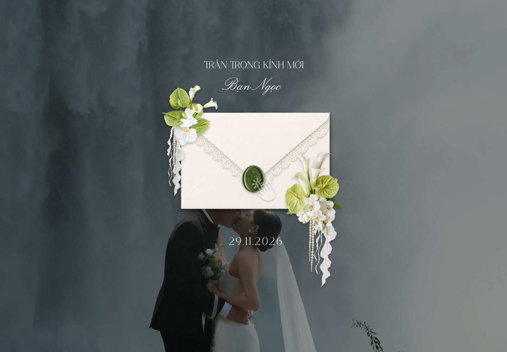
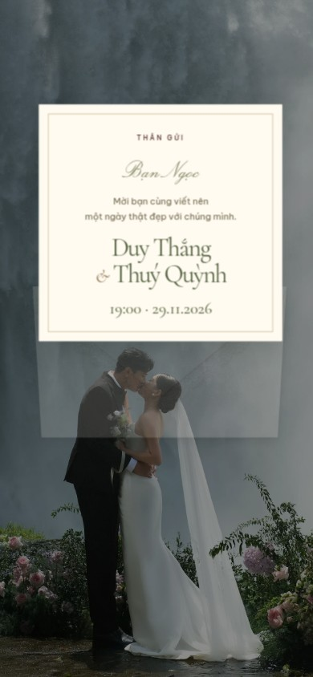

# Kiểm tra giao diện — 27/10/2026

Đây là ảnh chụp từ trang được render trong Chromium, sử dụng ảnh và font thật của dự án.

## Thay đổi theo phản hồi mới nhất

- Màn mở đầu dùng đúng artwork của mẫu `https://jmiiwedding.com/duyanhhamauu/`: phong bì ren, hai cụm hoa trắng/lá xanh, dấu sáp xanh và bàn tay.
- Dùng đúng hai font của mẫu cho lời kính mời, tên khách và ngày tiệc. Tỷ lệ/vị trí các lớp lấy từ canvas 420×765.178; một bài kiểm tra Chromium đối chiếu vị trí với sai số dưới 1px trên canvas gốc.
- Phong bì hiện sau 1 giây, hoa trái hiện trong 1,5 giây sau khoảng chờ 1 giây, hoa phải hiện sau khoảng chờ 1,5 giây; con dấu pulse, bàn tay bounce theo chu kỳ 1 giây như mẫu.
- Nền dùng ảnh cưới của Thắng và Quỳnh; ngày hiển thị 29.11.2026. Tên khách cá nhân hoá qua `?to=...` được hiển thị an toàn cả ở màn đầu và lá thư.
- Nội dung thiệp vẫn ẩn và inert trước khi chạm thư. Một lần chạm mở lá thư rồi tự chuyển vào thiệp; nhạc lỗi không chặn luồng vào. Tôn trọng chế độ giảm chuyển động.
- Các ảnh chữ nhật và toàn bộ phần nội dung thiệp giữ bố cục đã sửa ở lượt trước.
- Xem [nguồn artwork và thông số chuyển động](opening-artwork.md).

## Màn mở đầu mới

### Mở link — desktop



### Mở link — điện thoại


### Chạm mở thư — điện thoại



## Kết quả kiểm thử

- **14/14** kiểm thử logic và DOM: múi giờ Việt Nam, ranh giới đếm ngược, lịch năm nhuận, ICS và escaping, lưu trữ lỗi, mở thiệp, album, RSVP và lời chúc an toàn.
- **15/15** kiểm thử trình duyệt: bảy viewport, đối chiếu bố cục/font/artwork/animation với mẫu, luồng phong bì/keyboard, album/keyboard, RSVP/reload, lời chúc, tải lịch, reduced motion/storage bị chặn, nhạc bật/tắt.
- Viewport: **320×740, 375×812, 390×844, 430×932, 768×1024, 1440×900, 1920×1080**.
- Đã đọc ảnh chụp cover điện thoại nhỏ/tablet/desktop, lời mời, sự kiện, album, RSVP, lời chúc và phong bì trên mobile/desktop; không có lỗi JavaScript trong lần thu ảnh mobile/desktop.
- Chưa kiểm chứng trên Safari/iOS thật. Screenshot và kiểm tra bounding box không thay thế việc đánh giá thẩm mỹ của cô dâu chú rể.

## Ảnh chụp

### Cover desktop — 1440×1000


### Cover điện thoại — 390×844


### Thiệp mở — điện thoại


### Lời mời — desktop


### Ngày tiệc — điện thoại


### Ngày tiệc — tablet sau khi sửa ngắt dòng


### Album — desktop


### Xác nhận — điện thoại


Một số ảnh toàn section dùng `prefers-reduced-motion: reduce` để mọi khối đều hiển thị khi chụp; ảnh cover được chụp sau khi hiệu ứng ban đầu kết thúc. Các nút cố định trong ảnh toàn section phản ánh vị trí viewport lúc chụp. Toàn bộ luồng mở thiệp còn được test với chế độ chuyển động thông thường.

## Chạy lại

```sh
npm ci
npx playwright install chromium
npm test
npm run test:ui
npm run build
```

Ảnh chụp ở bảy kích thước và báo cáo HTML được upload trong workflow dưới artifact `browser-test-evidence`. Khi có thay đổi giao diện, chạy lại browser tests và `npm run review:ui`, đọc ảnh trước khi cập nhật ảnh trong thư mục này.
