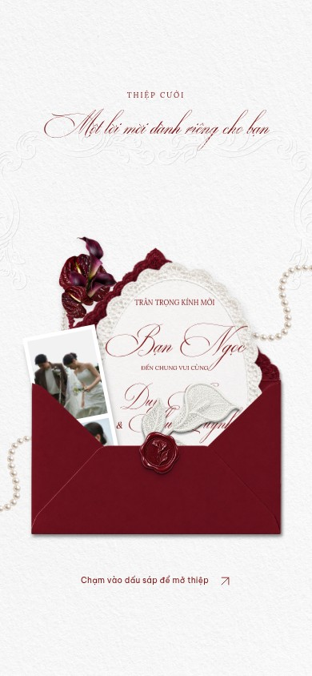
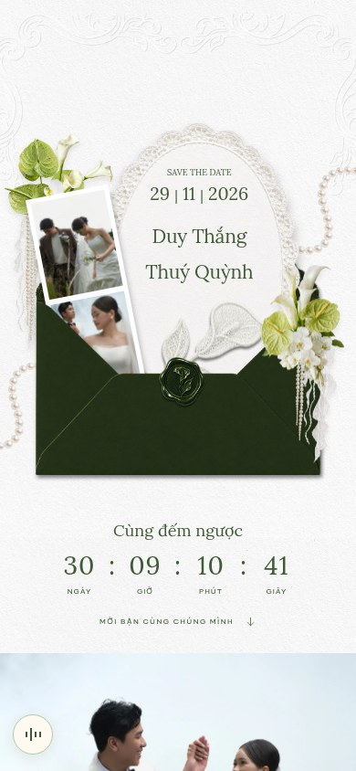
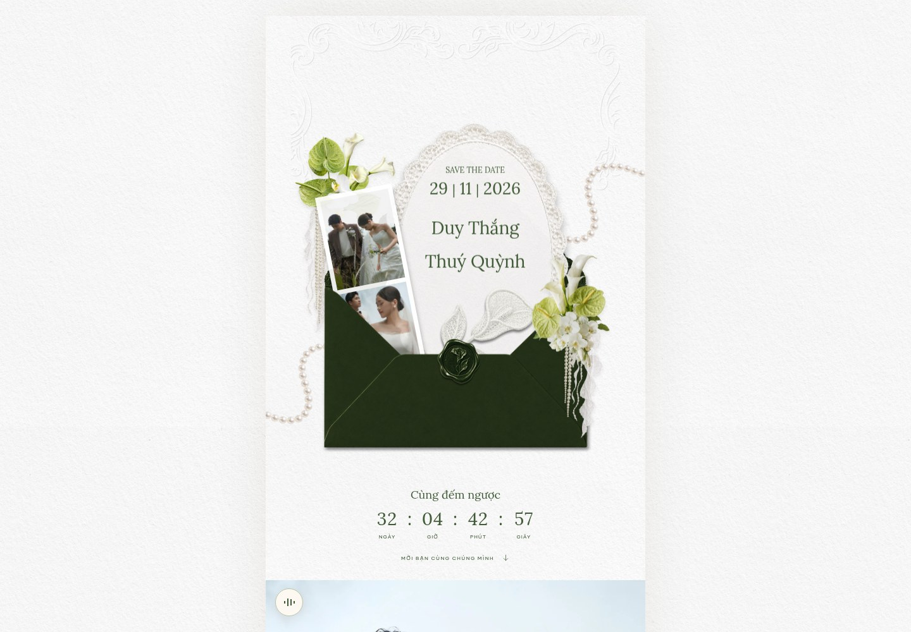
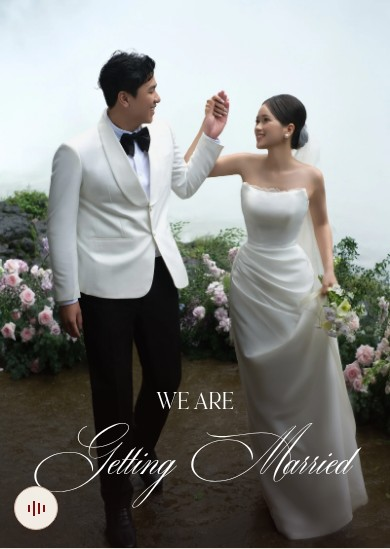
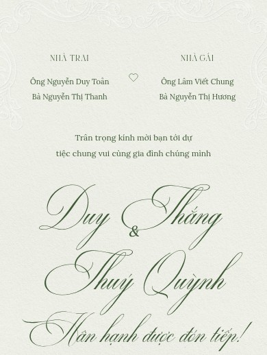
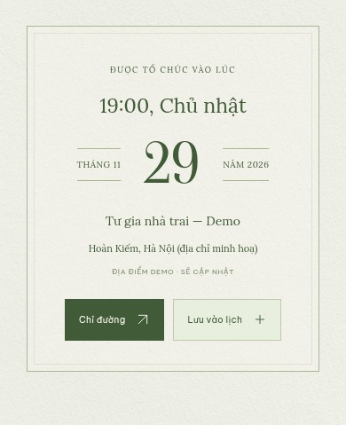
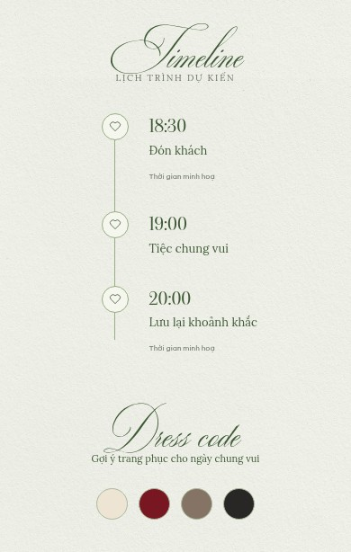
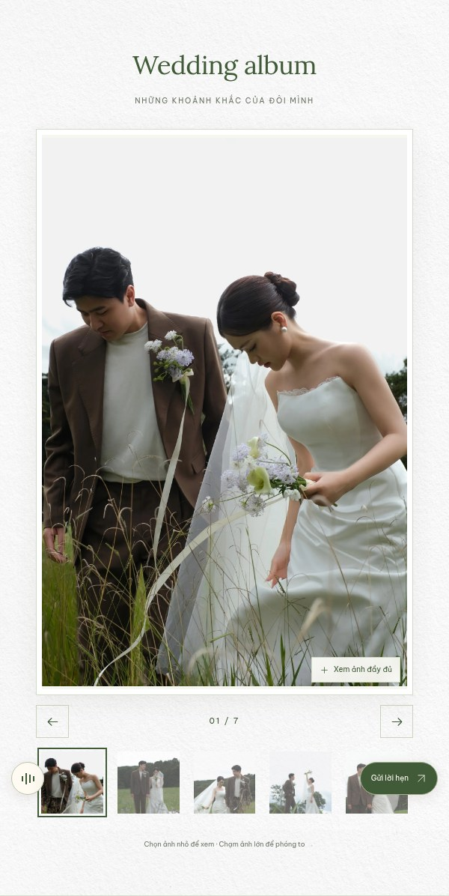
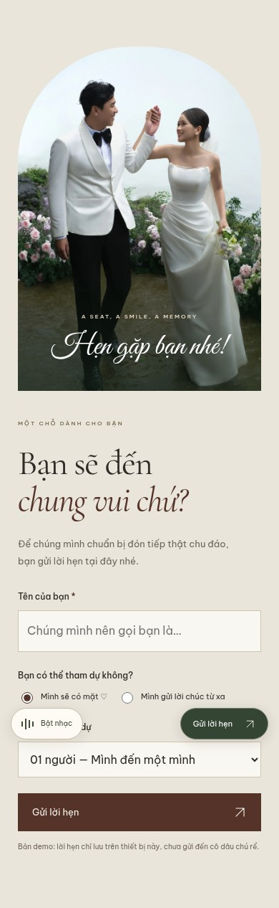
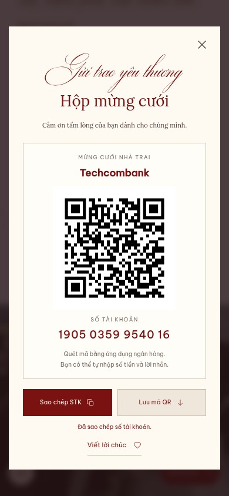

# Kiểm tra bố cục Chinh–Linh — 27/10/2026

Tham chiếu: https://jmiiwedding.com/chinhlinhh. Ảnh dưới đây được chụp từ Chromium với ảnh và dữ liệu của Thắng & Quỳnh.

## Đã thay đổi

- Đổi toàn bộ bố cục sang cuốn thiệp dọc, nền giấy trắng và mực đỏ rượu vang; phong bì, giấy ren, ngọc trai và dải ảnh theo mẫu mới.
- Màn mở và trang 1 dùng chung các lớp đồ hoạ. Chạm phong bì sẽ hạ mặt phong bì, kéo giấy và ảnh lên, phát nhạc sau tương tác rồi chuyển vào thiệp. Nội dung ẩn và khóa trước thao tác mở.
- Trang 2 dùng ảnh cưới toàn khung và dòng “We are Getting Married”.
- Không có mục Our Story, đoạn hành trình tình yêu hay phần chân dung kể chuyện.
- Bố cục tiếp theo: gia đình → thời gian/địa điểm → lịch trình dự kiến/gợi ý trang phục → lịch → album → RSVP → lời chúc → mừng cưới → cảm ơn.
- Thông tin demo được ghi rõ; không dùng ảnh hoặc API của cặp đôi mẫu.

## Kiểm thử

- **17/17 logic/DOM** đạt.
- **17/17 Chromium** đạt, gồm bảy viewport: 320×740, 375×812, 390×844, 430×932, 768×1024, 1440×900, 1920×1080.
- Kiểm tra khung đầu không tràn ngang, tên/ngày/nút tiếp trong viewport, chặn nội dung trước khi mở, mở một lần, Escape không bỏ qua gate, tải lại quay về màn mở, nhạc, lịch, album, RSVP và lời chúc.
- Bài riêng xác nhận các lớp phong bì đỏ, dải hai ảnh, trang thứ hai và không có Our Story.
- Đã xem ảnh render màn mở, trang 1, trang 2, lời mời, sự kiện, album và biểu mẫu trên mobile/desktop. Chưa xác nhận Safari/iOS thật.

## Màn mở



## Trang 1





## Trang 2



## Lời mời và thời gian





## Lịch trình và album





## Xác nhận



Ảnh toàn section dùng reduced motion để các khối hiện đủ khi chụp. Các luồng mở thiệp và bảy viewport còn được kiểm tra với chuyển động thông thường. Một số bài tương tác biểu mẫu dùng reduced motion để tách lỗi biểu mẫu khỏi chuyển động cuộn.

## Chạy lại

```sh
npm ci
npx playwright install chromium
npm test
npm run test:ui
npm run build
```

GitHub Actions lưu báo cáo/ảnh/trace trong artifact `browser-test-evidence`. Ảnh review có thể tạo bằng `npm run review:ui` sau khi mở Vite ở cổng 5173.

## QR nhà trai

Đã thêm VietQR Techcombank cho số tài khoản **1905 0359 9540 16**. Đã giải mã cả ảnh PNG gốc và ảnh QR render trong trình duyệt, xác nhận BIN 970407 và tài khoản 19050359954016, không đặt sẵn số tiền. Đã kiểm tra sao chép đúng chuỗi số, tải PNG, báo lỗi khi clipboard bị chặn và bố cục hộp mừng cưới ở 320px, 390px, 1440px.


